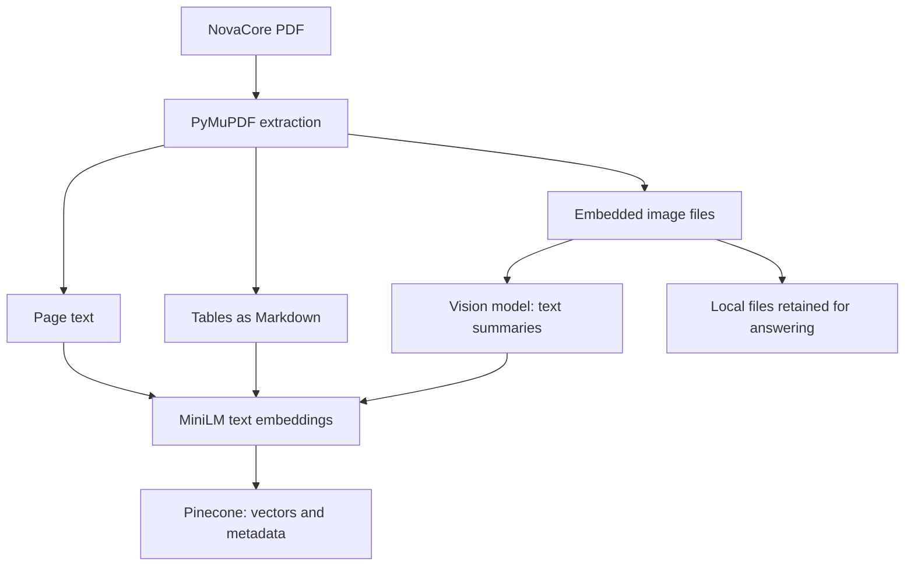
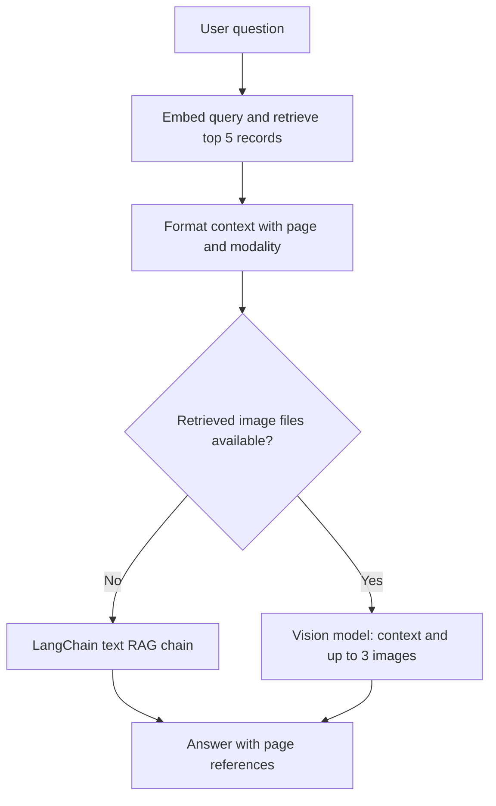
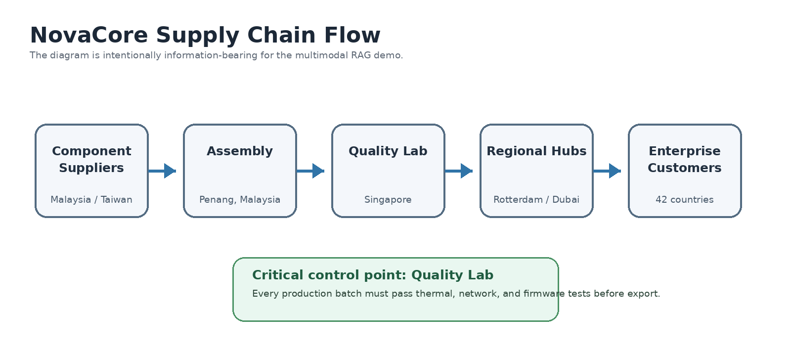
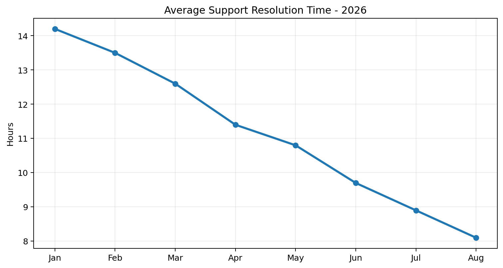

# Multimodal RAG — NovaCore Company Report

**Ask questions across text, tables, charts, and diagrams in a single PDF.**

This project demonstrates an end-to-end Retrieval-Augmented Generation (RAG) workflow using a fictional FY2026 company report. It extracts several content types, builds a shared searchable representation, and uses retrieved evidence to generate answers with page references.

Built by **Pooja D Anchan** as a hands-on learning project following the [DSwithBappy Multimodal RAG tutorial](https://www.youtube.com/watch?v=ZVSBCUDr01U).

[Open the notebook](Build_Multimodal_RAG_NovaCore.ipynb) · [View the source report](NovaCore_Multimodal_Company_Report_2026.pdf) · [Repository](https://github.com/pooja-d-anchan/Advanced_RAG)

> NovaCore and all company figures in the report are fictional. This is a tested notebook demonstration, not a production deployment or an accuracy benchmark.

## What the project demonstrates

- Extracting page text, structured tables, and embedded images with PyMuPDF.
- Converting tables into Markdown and visuals into searchable text summaries.
- Generating local, normalized text embeddings with a Hugging Face model.
- Storing and retrieving records through Pinecone with page and modality metadata.
- Routing answers to a text model or a vision model based on available retrieved images.
- Displaying retrieved visuals and inspecting the evidence behind an answer.

## Architecture

### Ingestion



### Question answering



**The embedding model receives text representations, including visual summaries—not raw image pixels.** Original images are loaded again when generating a vision answer. Pinecone stores their paths; the image files themselves remain local.

## Technology stack and configuration

| Component | Implementation |
| --- | --- |
| Runtime | Python; saved notebook metadata reports Python 3.12.4 |
| Development | VS Code, Jupyter notebook, uv virtual environment |
| PDF processing | PyMuPDF |
| Table conversion | pandas and tabulate |
| Image processing | Pillow |
| Orchestration | LangChain |
| Embeddings | `sentence-transformers/all-MiniLM-L6-v2` |
| Vector dimension | 384, detected programmatically |
| Normalization | `normalize_embeddings=True` |
| Vector database | Pinecone serverless, AWS `us-east-1`, cosine metric |
| Index / namespace | `novacore-multimodal-rag` / `fy2026-demo` |
| Text model via Groq | `openai/gpt-oss-20b` |
| Vision model via Groq | `qwen/qwen3.8-27b` |
| Retrieval | Top 5 records |
| Vision answer | Up to 3 images; temperature 0 |
| Credentials | `.env`, loaded using python-dotenv |

These are the notebook's recorded settings. Groq listed the vision model as a **preview model** when checked on 28 September 2026; check [current model availability](https://console.groq.com/docs/models) before reproducing the project.

## Project files

This README belongs inside `Advanced_RAG/Multimodal_RAG/`.

| File or folder | Purpose |
| --- | --- |
| `README.md` | Project overview and setup instructions |
| `Build_Multimodal_RAG_NovaCore.ipynb` | Implementation and saved demonstration outputs |
| `NovaCore_Multimodal_Company_Report_2026.pdf` | Fictional source report |
| `novacore_extracted_images/` | Extracted charts, diagrams, and other image evidence |
| `.gitignore` | Project-level ignore rules |
| `.env` | Local API keys; must remain untracked |

The repository root also contains Git configuration files. Keep the extracted images available at these relative paths; they can also be regenerated during ingestion.

## Getting started

### 1. Clone and open the project

```powershell
git clone https://github.com/pooja-d-anchan/Advanced_RAG.git
cd Advanced_RAG/Multimodal_RAG
code .
```

You need uv, VS Code with Microsoft's Python and Jupyter extensions, a Groq API key, and a Pinecone API key. Run the following commands in PowerShell from the project folder.

### 2. Create an environment and install dependencies

```powershell
uv venv --python 3.12 .venv
uv pip install --python .venv/Scripts/python.exe pip ipykernel langchain langchain-core langchain-groq langchain-huggingface langchain-pinecone pinecone sentence-transformers pymupdf groq pandas tabulate pillow python-dotenv
```

This installs the notebook's direct dependencies plus its kernel runtime. The versions are unpinned; the uploaded notebook does not provide a complete dependency lockfile.

In VS Code, select **Select Kernel → Select Another Kernel → Python Environments**, then choose `.venv/Scripts/python.exe`.

If the environment is not listed, register it and reload VS Code:

```powershell
& .venv/Scripts/python.exe -m ipykernel install --user --name novacore-rag --display-name "Python (NovaCore RAG)"
```

Confirm the selected interpreter in a notebook cell:

```python
import sys
print(sys.executable)
```

### 3. Configure credentials

Create `.env` in `Multimodal_RAG/` and fill in your own values:

```dotenv
GROQ_API_KEY=your_groq_api_key
PINECONE_API_KEY=your_pinecone_api_key
```

The notebook discovers and loads the file with:

```python
from dotenv import find_dotenv, load_dotenv

env_path = find_dotenv(usecwd=True, raise_error_if_not_found=True)
load_dotenv(env_path, override=True)
```

The search starts in the kernel's working directory and moves upward. Run from the intended project folder. The notebook validates that both keys are present without printing their values.

Ensure `.env` is ignored by Git. An optional `.env.example` can contain the same variable names with empty values.

### 4. Run the notebook

Keep the PDF beside the notebook, then run the cells in order:

1. Imports, PDF path, model settings, and credentials.
2. Image helpers and multimodal extraction.
3. Inspect extracted documents and modality counts.
4. Load the embedding model and detect its dimension.
5. Create/connect to Pinecone, reset the demo namespace, and upload records.
6. Inspect retrieval results and construct the answer functions.
7. Run the demonstration questions and review their sources.

The initial package-install cell uses upgrades; skip it if dependencies have already been installed with versions you intend to preserve. The separate Pillow reinstall cell is troubleshooting history and is not a routine prerequisite.

> **Namespace reset:** the cleanup cell deletes every vector in `fy2026-demo`. Use a dedicated demo namespace. The saved run encountered a namespace-not-found 404 before a successful upload; other cleanup failures should not be assumed harmless.

Network access is required for the initial model download, Groq calls, and Pinecone operations. Embedding inference runs locally after model download. Re-running ingestion repeats visual-summary calls and may incur provider usage charges.

## Example usage

Run these after defining `ask_rag` and completing ingestion:

```python
result = ask_rag(
    "Which region had the highest year-over-year revenue growth?",
    show_sources=True,
    show_images=True,
)

print(result["answer"])
```

```python
result = ask_rag(
    "According to the supply-chain diagram, what is the critical quality-control point?",
    show_images=True,
)
```

A multi-part question:

```python
result = ask_rag(
    """Give me a short FY2026 performance summary.
Include total revenue, the fastest-growing region,
support-resolution improvement, and solar share at Penang.""",
    show_images=True,
)
```

`ask_rag` prints the answer and, by default, retrieved source labels. It returns:

| Return field | Contents |
| --- | --- |
| `answer` | Generated answer text |
| `documents` | Retrieved LangChain Documents |
| `image_paths` | Available retrieved image paths |

`show_images=True` controls display in the notebook; it does not decide whether the vision model is used. In the uploaded notebook's final demo cell, this flag appears inside the question string. The example above shows its correct placement as a keyword argument.

## Saved testing results

The saved extraction run processed **9 pages** and produced **24 Documents**:

| Modality | Records |
| --- | ---: |
| Text | 9 |
| Tables | 8 |
| Visual summaries | 7 |
| **Total** | **24** |

The notebook includes successful upload/retrieval output, a retrieval-only inspection, and seven answered demonstrations. Testing was reported complete on 28 September 2026.

| Question | Recorded answer | Observation |
| --- | --- | --- |
| What does NovaCore do, and where is it headquartered? | Industrial AI/IoT products; Singapore | Text-only retrieved evidence |
| Which region had the highest YoY growth? | Europe, 31% | Both visual and table evidence retrieved |
| Which quarter had the highest revenue? | Q4 2026, approximately $37.5M | Quarter correct; plotted value appears closer to $37.8M |
| What is the critical quality-control point? | Quality Lab, Singapore | Diagram and text evidence |
| How did support resolution time change? | 14.2 hours to 8.1 hours | Reduction of 6.1 hours, approximately 43% |
| What share of electricity came from solar? | 34% | Pie chart and facility illustration retrieved |
| Summarize FY2026 performance | $132M revenue; Europe 31%; support 8.1h; solar 34% | Support baseline and quantified improvement omitted |

These results demonstrate the workflow and expose useful improvement opportunities. They are not a formal accuracy score, clean-kernel replay, or performance benchmark. Answers and retrieval ordering can change between runs.

### Sample visual evidence

**Supply-chain diagram used for quality-control questions:**



**Support-resolution chart used for trend questions:**



## Implementation details

| Function | Responsibility |
| --- | --- |
| `image_to_data_uri()` | Converts an image to RGB, resizes within 1600 × 1600, and encodes a JPEG data URI |
| `summarize_visual()` | Creates a factual text description using the vision model |
| `extract_multimodal_documents()` | Extracts text, Markdown tables, and image-summary Documents with metadata |
| `format_context()` | Adds page and modality labels to retrieved content |
| `answer_with_vision()` | Sends the question, context, and up to three images to the vision model |
| `ask_rag()` | Retrieves evidence, routes generation, and displays/returns results |

Text records retain `page`, `modality`, and `source`. Tables additionally retain `table_number`; visuals retain `image_path`. Repeated embedded-image xrefs are processed once across the PDF.

## Known limitations and improvements

- **No explicit chunking:** page text is embedded as a whole. The MiniLM model card specifies a default 256-word-piece truncation limit, so long pages may not be fully represented in their vectors. Add token-aware splitting and evaluate its effect.
- **Extraction coverage:** embedded-image extraction does not cover every vector-drawn chart or scanned-text scenario. Page rendering and OCR would broaden coverage.
- **Visual accuracy:** generated descriptions can misread numerical values, as the revenue-peak example shows. Check exact values against the original chart or structured source data.
- **Evidence coverage:** top five results may miss part of a multi-part question. The combined-summary run omitted page 7 and lacked the support baseline. Question decomposition is a useful next experiment.
- **Local assets:** unavailable image paths silently trigger a text fallback when no usable images remain. Add explicit missing-asset reporting and portable asset references.
- **Repeat ingestion:** stable record IDs are not supplied. Skipping the namespace reset can create duplicate records on repeated uploads.
- **Operational safeguards:** validate existing-index dimensions/metric, add bounded retries and timeouts, and record model usage and latency.
- **Evaluation:** add automated checks for answerability, retrieval relevance, numerical accuracy, and citation support.

## References and attribution

- [DSwithBappy tutorial: Build Advanced Multimodal RAG End-to-End](https://www.youtube.com/watch?v=ZVSBCUDr01U)
- [MiniLM embedding model card](https://huggingface.co/sentence-transformers/all-MiniLM-L6-v2)
- [Groq model documentation](https://console.groq.com/docs/models)
- [PyMuPDF documentation](https://pymupdf.readthedocs.io/)
- [Pinecone documentation](https://docs.pinecone.io/)
- [python-dotenv documentation](https://bbc2.github.io/python-dotenv/)

This project follows an educational tutorial and documents the implementation, testing, and observations from a hands-on run. Retain applicable upstream attribution and licenses when reusing code or assets.
